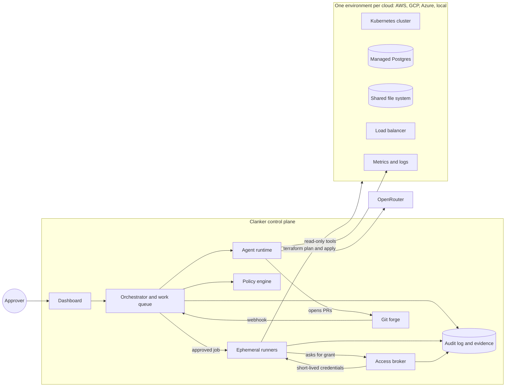
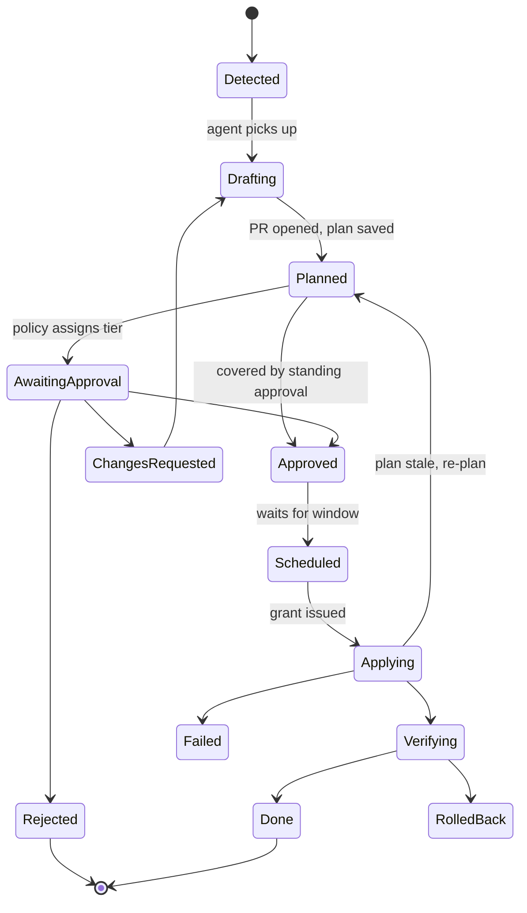

# Site Reliability Clanker — prototype plan

An AI site reliability engineer, presented as a dashboard, that deploys and then looks after a
multi-service application on AWS, Google Cloud and Azure. It watches the system, works out what
maintenance is due, writes the change as infrastructure as code, explains it to a human approver
in plain language, and applies it with short-lived permissions once approved. Everything it did,
and everything it intends to do, is browsable.

This document covers the architecture, the use cases, the permissions model and the build order.

## 1. Principles

These five rules shape most of the design decisions below.

1. **The model proposes and explains; deterministic code decides and executes.** The LLM drafts
   Terraform changes, summaries and answers. It never classifies its own risk, never holds a
   cloud credential, and has no tool that applies a change. Risk tier, approval requirement and
   execution come from policy code and a runner.
2. **Every change is a pull request.** No console clicks, no ad-hoc `kubectl apply`. If the agent
   wants something changed, it changes a repository and a pipeline does the rest. Even "restart
   that deployment" is a recorded, parameterised runbook job.
3. **What was approved is exactly what runs.** An approval is bound to a commit and to the hash
   of a saved Terraform plan. If the world moved and the plan is stale, the apply fails and the
   work goes back for re-approval.
4. **No standing write access.** Read-only by default. Write permissions exist only for the
   duration of one approved job, scoped to the layer that job touches.
5. **Multi-cloud is a contract, not a port.** One interface, four implementations (AWS, GCP,
   Azure, and a local target), and one conformance suite that all four must pass from the first
   milestone onward.

## 2. What gets built

Three things, kept deliberately separate:

| Piece | What it is | Why it exists |
|---|---|---|
| **Paperboat** (the workload) | A small multi-service document-sharing app | Something realistic to operate: needs a database, a shared file system, a load balancer, and has versioned releases |
| **Platform** (the IaC) | Terraform modules and per-environment stacks for each cloud | The thing the agent actually edits |
| **Clanker** (the control plane) | Dashboard, agent, runner, access broker, git forge, audit log | The product concept being prototyped |

A fourth piece, the **simulator**, makes the lifecycle demonstrable in minutes instead of months:
it publishes new app releases, injects advisories and faults, and advances a virtual clock.



## 3. The managed workload: Paperboat

Small enough to build in days, shaped like a typical enterprise app.

| Service | Role | Depends on |
|---|---|---|
| `web` | Browser UI | `api` via the load balancer |
| `api` | REST API, auth, metadata | Postgres, shared file system |
| `worker` | Background jobs (previews, indexing) | Postgres, shared file system |
| `migrate` | Schema migration job run on each release | Postgres |
| `loadgen` | Synthetic traffic so SLOs and graphs mean something | `web` |

`api` and `worker` mount the same volume read-write-many, which is what forces a real network
file system on each cloud instead of a block disk.

Releases are pre-built so upgrade scenarios are repeatable:

- `1.0.0` — initial deployment
- `1.1.0` — feature release with a schema migration
- `1.1.1` — security patch (base image CVE)
- `1.2.0-bad` — deliberately faulty release, for the failed-canary and rollback scenario

Packaged as a Helm chart, deployed through Terraform so the app follows the same
plan-approve-apply path as the infrastructure.

## 4. Multi-cloud platform

### 4.1 The contract

Each cloud implements the same module interface. Stacks above the contract are cloud-agnostic.

| Capability | Contract output | AWS | Google Cloud | Azure | Local |
|---|---|---|---|---|---|
| Kubernetes | cluster endpoint, auth | EKS | GKE | AKS | kind |
| Postgres | host, port, admin secret ref | RDS for PostgreSQL | Cloud SQL for PostgreSQL | Azure Database for PostgreSQL flexible server | CloudNativePG in-cluster |
| Shared file system | RWX `StorageClass` name | EFS + CSI driver | Filestore + CSI driver | Azure Files (NFS) + CSI driver | NFS provisioner |
| Load balancer | `GatewayClass`, public address | NLB | Cloud Load Balancing | Azure Load Balancer | cloud-provider-kind |
| Object storage | bucket for backups and evidence | S3 | Cloud Storage | Blob Storage | MinIO |
| Secrets | secret store reference | Secrets Manager | Secret Manager | Key Vault | Kubernetes secrets |
| Workload identity | pod-to-cloud identity binding | EKS Pod Identity | Workload Identity Federation | Entra Workload ID | none |
| Terraform state | remote backend with locking | S3 | Cloud Storage | Blob Storage | MinIO |
| Cloud audit trail | source for cross-checking | CloudTrail | Cloud Audit Logs | Activity Log | Kubernetes audit log |

Ingress uses the Kubernetes Gateway API with one portable implementation (Envoy Gateway) on
every cloud, fronted by that cloud's L4 load balancer. That keeps application routing identical
everywhere while still provisioning a real cloud load balancer. Cloud-native L7 can be swapped in
behind the same contract later.

The **local target** is a first-class fourth cloud, not a mock. It runs the same stacks and the
same control plane on a laptop with no cloud bill, which is what makes the prototype demoable and
keeps the development loop short.

### 4.2 Stack layering

Each environment is split into small Terraform states. This limits blast radius, keeps plans
readable, and lets credentials be scoped per layer.

| Layer | Contents | Change frequency | Typical risk |
|---|---|---|---|
| `00-bootstrap` | State backend, identity trust, agent roles | Rare | High |
| `10-network` | VPC/VNet, subnets, NAT, private endpoints | Rare | High |
| `20-cluster` | Control plane, node pools, cluster add-ons | Monthly | Medium |
| `30-data` | Postgres, file system, buckets, backup policy | Monthly | High |
| `40-platform` | Gateway, cert-manager, secrets operator, observability | Monthly | Medium |
| `50-app` | Paperboat Helm release and config | Weekly | Low to medium |

### 4.3 Conformance suite

One test suite run against any environment: cluster reachable, RWX volume shared between two pods,
Postgres reachable over a private path with TLS, public address serves the app, a backup can be
taken and restored, workload identity can read its secret. A cloud is "supported" when this
passes. It runs in CI nightly against all four targets using ephemeral environments with a TTL.

## 5. Clanker control plane

| Component | Responsibility | Prototype choice |
|---|---|---|
| Dashboard | Work queue, plan review, fleet health, chat, audit, access views | React single-page app served by the orchestrator |
| Orchestrator | Work-item state machine, scheduling, maintenance windows, webhooks | Go service, Postgres for state |
| Agent runtime | LLM loop with typed tools, per-role tool sets, cost budget | Go, OpenRouter chat completions with tool calling |
| Policy engine | Turns a plan into a risk tier and approval requirement | OPA/Rego over `terraform show -json` output |
| Runner | Runs plan, policy check and apply in a throwaway container | One container per job, no network egress beyond what the job needs |
| Access broker | Verifies grants, mints short-lived credentials, revokes on completion | Go service, the only component holding cloud trust |
| Git forge | Hosts repos, PRs, code browsing | Forgejo, bundled |
| Audit log | Append-only, hash-chained event record; evidence export | Postgres table plus periodic export to object storage |
| Detectors | Scheduled read-only checks that open work items | Plain code, not LLM |
| Simulator | Virtual clock, advisory feed, release publisher, fault injection | Separate service, disabled outside demo mode |

Repositories hosted in the forge:

- `platform-modules` — the per-cloud modules and the contract
- `platform-live` — one directory per environment and layer; the agent's PRs land here
- `paperboat` — application source, chart and release notes
- `runbooks` — parameterised operational jobs and the policies that govern them

### 5.1 Work item lifecycle

Everything the dashboard shows is a work item moving through one state machine.



### 5.2 Agent design

The agent is several narrow roles rather than one general one. Each role has its own tool set,
and that tool set is the security boundary.

| Role | Does | Tools | Cannot |
|---|---|---|---|
| Triage | Reads detector findings, groups and prioritises, opens work items | Read metrics, logs, cloud inventory, advisories | Touch repos or credentials |
| Author | Writes the Terraform or runbook change and opens a PR | Read repos, write to a branch, request a plan | Merge, approve, apply |
| Explainer | Writes the approval summary and answers questions | Read plan JSON, PR diff, history, audit log | Change anything |
| Investigator | Diagnoses incidents under a debug grant | Scoped read tools, recorded session commands | Make persistent changes |

Safeguards:

- **Untrusted input.** Logs, alerts, release notes and advisories are data, never instructions.
  Since the agent has no apply tool, a successful prompt injection can at most produce a PR that
  a human then sees with a policy-assigned tier.
- **Faithful summaries.** Counts, resource names, replace/destroy flags and cost deltas on the
  approval page come from the plan JSON directly. The LLM writes prose around those facts and
  cannot alter them.
- **Redaction.** Tool outputs pass through a secret scrubber before reaching the model. Terraform
  state is never sent.
- **Replay mode.** Recorded model responses let the full demo run without a key or network.

### 5.3 Inference through OpenRouter

- OpenAI-compatible endpoint, one key, model chosen per role in configuration (a stronger model
  for authoring and investigation, a cheaper one for triage and summaries).
- The key is entered once at bootstrap, stored in the secret store, and never written to git or
  shown to runners.
- Per-work-item and per-day spend caps enforced by the agent runtime; every call logs model,
  token counts, cost and the work item it served.
- Full prompt and response transcripts are kept as evidence attached to the work item.
- Telemetry leaves your boundary when it is sent to a model. An allowlist controls which data
  classes may be included, with the default excluding application data and secrets.

## 6. Permissions and just-in-time access

### 6.1 Identities

| Identity | Standing access | Elevation |
|---|---|---|
| `observer` | Read-only on cloud inventory, metrics, logs, Kubernetes `view`. No secret values | None |
| `planner` | Read-only plus state read, enough to run `terraform plan` | None |
| `applier-<layer>` | **None** | Assumable only with a valid grant for that layer |
| `debugger` | **None** | Time-boxed, namespace-scoped, session recorded |
| `broker` | May mint credentials for the identities above. No resource permissions itself | None |
| Human `viewer` / `approver` / `admin` | Dashboard roles | Break-glass is human-only and loudly logged |

### 6.2 Grants

A grant is a signed record that the broker exchanges for credentials:

```
work_item   WI-0142
environment aws-prod
layer       30-data
commit      9f3c1e7
plan_sha256 5b1d…e02a
tier        T3
approvers   alice, bob
not_before  2026-11-21T02:00Z
expires     2026-11-21T03:00Z
```

The runner presents the grant, the broker checks signature, approvals, window and plan hash, then
issues credentials that expire with the grant and are revoked when the job ends.

| Mechanism | AWS | Google Cloud | Azure | Kubernetes | Postgres |
|---|---|---|---|---|---|
| Short-lived credential | STS `AssumeRole` with a session policy | Service account impersonation token | Federated token for a per-layer managed identity | `TokenRequest` for a per-tier service account | IAM / Entra database auth token |
| Time bound | Session duration | Token lifetime, IAM Conditions | Role assignment created at grant, deleted at expiry | Token expiry | Token expiry |
| Guard rail | Permission boundary on every agent role | Deny policies, org constraints | Role-assignment conditions limiting what the broker may assign | RBAC per namespace | Role membership |
| Audit correlation | Work item ID as role session name | Impersonation chain in audit logs | Assignment description and tags | Token audience and audit log | Session `application_name` |

### 6.3 Risk tiers

Assigned by policy from the plan, never by the model.

| Tier | Meaning | Examples | Approval |
|---|---|---|---|
| T0 | Read-only | Detectors, diagnostics, Q&A | None |
| T1 | Routine and reversible | Restart a deployment, run a backup verification, scale within set bounds | Covered by a standing approval a human signed once; each use logged |
| T2 | Normal change | App release, node pool roll, add-on upgrade, parameter change | One approver |
| T3 | High risk | Anything replacing or destroying stateful resources, database major version, network or IAM changes | Two approvers and a maintenance window |

### 6.4 Bootstrap

One command, run once per cloud by a human administrator using their own credentials:

```
clanker bootstrap --cloud aws|gcp|azure|local --env <name>
```

It applies the `00-bootstrap` layer: state backend, the identity set above with guard rails, and
the trust relationship between the broker and the cloud. It prints exactly what it created and
stores none of the administrator's credentials. After that, the control plane starts with
`docker compose up` (prototype) or a Helm install (later), and the first work item it opens is
the blank-slate deployment.

Prototype trust is a single narrowly-scoped broker credential per cloud that can only mint the
identities above. The production path replaces that with workload identity federation so no
long-lived key exists anywhere.

## 7. The approver experience

### 7.1 Dashboard areas

| Area | Answers |
|---|---|
| **Overview** | Is each environment healthy? What needs me right now? |
| **Upcoming** | What work is scheduled or forecast, when, and why? |
| **Approvals** | What is waiting on a decision? |
| **Activity** | What ran, who approved it, what happened? Logs, plan and diff for each |
| **Code** | Repos, PRs and history (the forge, linked from every work item) |
| **Access** | Who and what holds which permission right now; grant history |
| **Audit** | Searchable event log; evidence export |
| **Ask** | Chat grounded in all of the above |

### 7.2 Approval page

Designed so someone accountable but not hands-on can decide in under a minute, and someone
hands-on can drill all the way to the raw plan.

1. **One sentence**: what will change and why now.
2. **Impact**: expected downtime, user-visible effect, cost change, how long it takes.
3. **Risk tier and the specific rule that set it.**
4. **What changes**: grouped, humanised diff ("replace 3 worker nodes one at a time"), with
   anything destroyed or replaced called out at the top.
5. **Safety**: pre-checks, backup taken first, rollback steps, verification after.
6. **Permissions requested**: the grant in plain language, with scope and duration.
7. **Evidence**: the finding that triggered it, links to PR, raw plan, policy result.
8. **Ask about this change**: inline chat scoped to this work item.
9. **Decide**: approve, approve and schedule, request changes, reject, defer (with the
   consequence of deferring stated).

### 7.3 Questions the agent must answer well

- What is waiting on me and what happens if I leave it a week?
- Are we behind on any patches? Which ones matter?
- What changed in production in the last 30 days, and who approved each change?
- When was the last successful restore test?
- Why did last night's upgrade take longer than planned?
- What will next month's maintenance look like?
- What does the agent have access to right now?

Answers cite work items, PRs and audit events, so every claim is one click from its source.

## 8. Use cases

The prototype scripts the ones marked ●. The rest are covered by the design and listed so the
data model does not paint us into a corner.

| # | Use case | Trigger | Layer | Tier | Proto |
|---|---|---|---|---|---|
| 1 | Bootstrap a cloud | Human | `00` | — | ● |
| 2 | Blank-slate deployment | First run | all | T3 | ● |
| 3 | Post-deploy conformance and SLO baseline | After 2 | — | T0 | ● |
| 4 | Application feature upgrade with migration | New release | `50` | T2 | ● |
| 5 | Application security patch | Image CVE advisory | `50` | T2 | ● |
| 6 | Failed canary and automatic rollback | Bad release | `50` | T2 | ● |
| 7 | Kubernetes version upgrade (control plane, then nodes) | Version nearing end of support | `20` | T2 | ● |
| 8 | Node OS image patch | Node image advisory | `20` | T2 | ● |
| 9 | Postgres minor version patch | Pending maintenance | `30` | T2 | ● |
| 10 | Postgres major version upgrade | End-of-life forecast | `30` | T3 | |
| 11 | Database maintenance: bloat, indexes, parameters | Detector | runbook | T1/T2 | ● |
| 12 | Storage growth: database or file system | Forecast | `30` | T2 | ● |
| 13 | Scheduled backups and retention | Policy | `30` | T1 | ● |
| 14 | Restore drill into a scratch environment | Monthly schedule | scratch | T1 | ● |
| 15 | Certificate and secret rotation | Expiry forecast | `40` | T1/T2 | |
| 16 | Drift detection and reconciliation | Nightly plan | any | varies | ● |
| 17 | Incident: alert, diagnosis, mitigation, write-up | Alert | — | T0→T2 | ● |
| 18 | Just-in-time debug session | Human or agent request | — | T1/T2 | ● |
| 19 | Provider, module and add-on upgrades | Release feeds | any | T2 | |
| 20 | Cost and capacity right-sizing | Detector | `20`/`30` | T2 | |
| 21 | Audit evidence pack and access review | Human | — | T0 | ● |
| 22 | Approver Q&A | Human | — | T0 | ● |
| 23 | Environment teardown | Human | all | T3 | ● |

The demo script strings these into one story per cloud: bootstrap, deploy, a quiet week, a
feature release, a CVE, a bad release that rolls back, a Kubernetes upgrade, database upkeep, a
restore drill, an incident at 2am, and finally an auditor asking for the evidence.

## 9. Build sequence

Each milestone ends with something runnable on **all four targets**. Nothing is built for one
cloud and ported later.

| # | Milestone | Delivers | Done when |
|---|---|---|---|
| M0 | Foundations | Repo layout, module contract, Paperboat 1.0.0 and chart, CI | Paperboat runs on the local target from one command |
| M1 | Blank slate everywhere | Per-cloud modules for all layers, bootstrap command, conformance suite | `terraform apply` from empty reaches a passing conformance run on AWS, GCP, Azure and local; teardown leaves nothing behind |
| M2 | Change pipeline | Forge, orchestrator, runner, policy tiers, approval page, audit log. No LLM yet | A hand-written PR goes plan → tier → approve → apply → verify through the dashboard, with logs and diff visible |
| M3 | Just-in-time access | Broker, grants, per-layer appliers, standing approvals, access view | Appliers have zero standing permissions; an apply without a valid grant, or with a stale plan, is refused on every cloud |
| M4 | The agent | OpenRouter client, roles and tools, detectors, plan explanations, Ask, replay mode | The agent notices a new release unprompted, opens the PR, and the approval page explains it accurately |
| M5 | Lifecycle | Simulator and use cases 4–16 | The scripted month runs end to end on each cloud |
| M6 | Incidents and audit | Investigator role, debug grants, incident write-ups, evidence export | Use cases 17, 18, 21 pass; the evidence pack reconciles against the cloud's own audit trail |
| M7 | Demo polish | Guided demo mode, seeded history, documentation | A newcomer can go from clone to full local demo in under 15 minutes |

Ordering notes:

- M2 comes before the agent on purpose. The pipeline, policy and audit trail must be trustworthy
  with a human author first; the agent then becomes just another PR author.
- M1 is the most expensive milestone and the most parallelisable: the three cloud modules can be
  built independently against the contract and the conformance suite.
- Cloud environments are ephemeral with a TTL from M1. Cost estimates are attached to every plan
  from M2.

## 10. Repository layout

```
/cmd/clanker            CLI: bootstrap, up, demo
/internal/orchestrator  work items, scheduler, webhooks
/internal/agent         roles, tools, OpenRouter client, replay
/internal/broker        grants, per-cloud credential minting
/internal/runner        plan, policy check, apply, log capture
/internal/policy        Rego rules and tier mapping
/internal/audit         hash-chained event log, evidence export
/internal/detect        detectors
/internal/sim           clock, advisories, releases, faults
/web                    dashboard
/platform/modules       contract plus aws, gcp, azure, local
/platform/stacks        00-bootstrap … 50-app
/apps/paperboat         services, chart, releases
/runbooks               parameterised jobs
/conformance            cross-cloud test suite
/deploy                 compose file and control-plane chart
/docs                   this plan, ADRs, demo script
```

`/platform`, `/apps/paperboat` and `/runbooks` are seeded into the forge at bootstrap; from then
on the forge copies are the source of truth for the running system.

## 11. Risks

| Risk | Mitigation |
|---|---|
| Three clouds triples the infrastructure work | Strict contract, conformance suite, local target for most development |
| Cloud spend during development | TTL on every environment, smallest viable sizes, nightly rather than per-commit cloud CI |
| Azure role assignments take time to propagate | Broker waits for the assignment to become effective before releasing the job; budget this into grant windows |
| Terraform state contains secrets | Encrypted backends, state readable only by planner and applier identities, never sent to the model |
| Model writes a plausible but wrong change | It still has to survive `validate`, plan, policy and a human; summaries are built from plan facts |
| Managed-service upgrades are slow and not always reversible | Simulator compresses time for demos; irreversible steps are always T3 with a verified backup first |
| The demo depends on a live model | Replay mode |

## 12. Decisions to confirm

Defaults are chosen so work can start; each is cheap to change before the milestone noted.

| Decision | Default | Alternative | Settle by |
|---|---|---|---|
| IaC binary | Terraform, written to stay OpenTofu-compatible | OpenTofu as the default | M0 |
| Control-plane language | Go backend, React front end | TypeScript throughout | M0 |
| Forge | Forgejo, bundled | Gitea, or an external GitHub/GitLab | M2 |
| Where the control plane runs | Docker Compose on one machine | Small dedicated management cluster | M3 |
| Broker trust for the prototype | One scoped credential per cloud | Workload identity federation from day one | M3 |
| Models per role | Configurable, set at bootstrap | Single model for everything | M4 |
