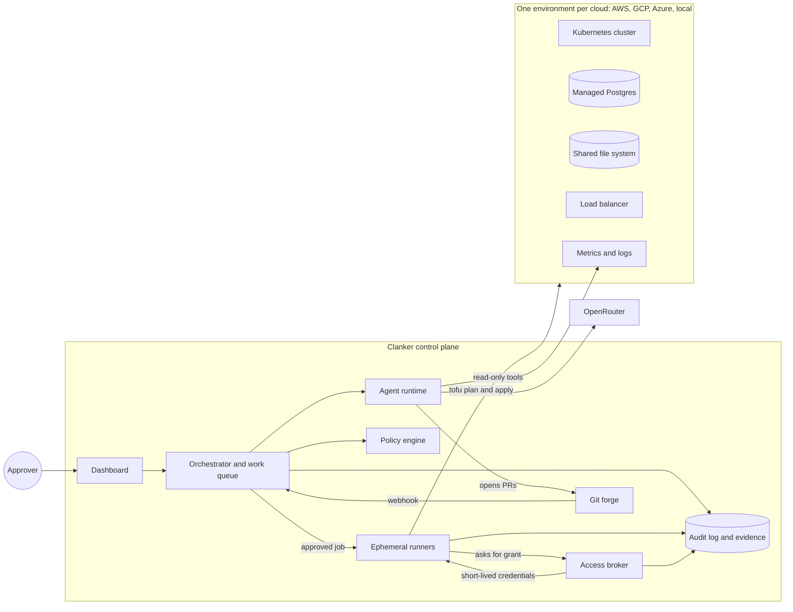
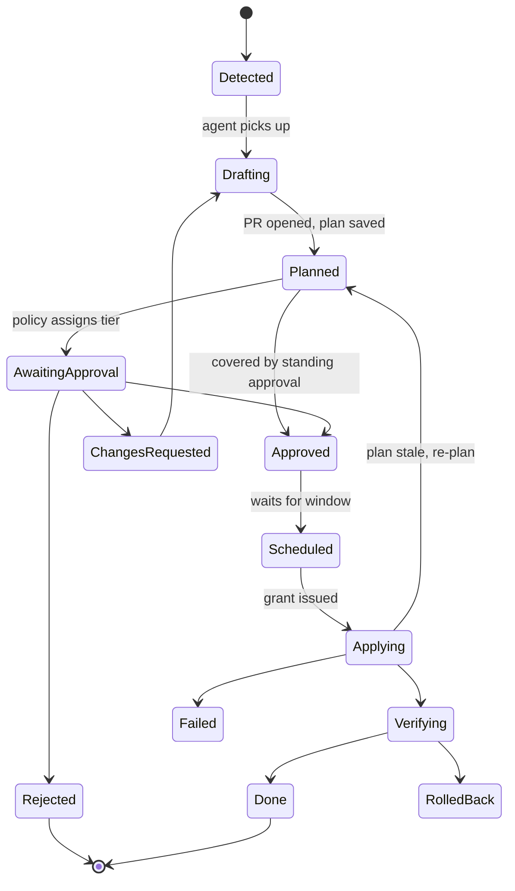

# Site Reliability Clanker — prototype plan

An AI site reliability engineer, presented as a dashboard, that deploys and then looks after a
multi-service application on AWS, Google Cloud and Azure. It watches the system, works out what
maintenance is due, writes the change as infrastructure as code, explains it to a human approver
in plain language, and applies it with short-lived permissions once approved. Everything it did,
and everything it intends to do, is browsable.

This document covers the architecture, the use cases, the permissions model and the build order.

## 1. Principles

These five rules shape most of the design decisions below.

1. **The model proposes and explains; deterministic code decides and executes.** The LLM drafts
   OpenTofu changes, summaries and answers. It never classifies its own risk, never holds a
   cloud credential, and has no tool that applies a change. Risk tier, approval requirement and
   execution come from policy code and a runner.
2. **Every change is a pull request.** No console clicks, no ad-hoc `kubectl apply`. If the agent
   wants something changed, it changes a repository and a pipeline does the rest. Even "restart
   that deployment" is a recorded, parameterised runbook job.
3. **What was approved is exactly what runs.** An approval is bound to a commit and to the hash
   of a saved OpenTofu plan. If the world moved and the plan is stale, the apply fails and the
   work goes back for re-approval.
4. **No standing write access.** Read-only by default. Write permissions exist only for the
   duration of one approved job, scoped to the layer that job touches.
5. **Multi-cloud is a contract, not a port.** One interface, four implementations (AWS, GCP,
   Azure, and a local target), and one conformance suite that all four must pass from the first
   milestone onward.

## 2. What gets built

Three things, kept deliberately separate:

| Piece | What it is | Why it exists |
|---|---|---|
| **Paperboat** (the workload) | A small multi-service fish rental app: real-time inventory, fish aging, delivery tracking and customer support interactions | Something realistic to operate: needs a database, a shared file system, a load balancer, and has versioned releases |
| **Platform** (the IaC) | OpenTofu modules and per-environment stacks for each cloud | The thing the agent actually edits |
| **Clanker** (the control plane) | Dashboard, agent, runner, access broker, git forge, audit log | The product concept being prototyped |

A fourth piece, the **simulator**, makes the lifecycle demonstrable in minutes instead of months:
it publishes new app releases, injects advisories and faults, and advances a virtual clock.



## 3. The managed workload: Paperboat

Small enough to build in days, shaped like a typical enterprise app. Paperboat is a fish rental
business: customers rent live fish, the business delivers them and collects them at the end of
the rental.

| Domain area | What the app tracks |
|---|---|
| Inventory | Each fish and each tank in real time: species, status (available, reserved, rented, in transit, quarantined, retired), location |
| Aging | Age and condition of each fish, updated by the worker; fish past the rental age limit for their species are retired from the rentable stock |
| Rentals | Reservation, rental period, return, pricing |
| Delivery | Delivery and collection jobs with status, driver, time window and a manifest document |
| Customer support | Tickets and interactions attached to a customer, rental or delivery |

| Service | Role | Depends on |
|---|---|---|
| `web` | Browser UI: live inventory board, rentals, deliveries, support desk | `api` via the load balancer |
| `api` | REST API and live inventory stream | Postgres, shared file system |
| `worker` | Background jobs: fish aging, delivery progress, manifest and health-certificate files, support escalation | Postgres, shared file system |
| `migrate` | Schema migration job run on each release | Postgres |
| `loadgen` | Synthetic customers so inventory moves and SLOs and graphs mean something | `web` |

`api` and `worker` mount the same volume read-write-many (fish photos, health certificates,
delivery manifests), which is what forces a real network file system on each cloud instead of
a block disk.

Releases are pre-built so upgrade scenarios are repeatable:

- `1.0.0` — initial deployment
- `1.1.0` — feature release with a schema migration
- `1.1.1` — security patch (base image CVE)
- `1.2.0-bad` — deliberately faulty release, for the failed-canary and rollback scenario

Packaged as a Helm chart, deployed through OpenTofu so the app follows the same
plan-approve-apply path as the infrastructure.

### 3.1 Unikernel packaging with Nanos (experimental track)

Every Paperboat service is a statically linked Go binary, so each can be packaged two ways from
the same build:

| Packaging | Runs on | Status in the plan |
|---|---|---|
| OCI image | Kubernetes on every target | Baseline; everything else in this plan assumes it |
| Nanos unikernel image, built with `ops` | QEMU locally; a native VM image on AWS, Google Cloud and Azure | Experimental track, one service first |

The track answers one question: does an AI SRE get an easier job when services are single-purpose
unikernel VMs (no shell, no package set to patch, small attack surface, image is the unit of
change) and what does it lose (no `exec`, different debugging, different rollout mechanics)?

Sequence:

1. Build `api` as a Nanos image and boot it under QEMU against the local Postgres. Requires KVM
   to be usable at reasonable speed.
2. Add a `compute-unikernel` variant of the app layer per cloud: instance group of unikernel
   VMs behind the same load balancer, same Postgres and file system, provisioned by OpenTofu.
   The contract gains a `workload_runtime` input (`kubernetes` or `unikernel`).
3. Run the upgrade, security-patch and rollback use cases against it and compare: an
   application patch becomes "build a new image and roll the instance group", and node OS
   patching disappears for those services.
4. Evaluate running the unikernel images inside the cluster (for example under KubeVirt) so
   both runtimes share one scheduler. Decide after step 3 whether this is worth doing.

Known constraints to design around: the shared file system must be reachable from a unikernel
(network file system client support needs checking per cloud), there is no in-guest debug
session so the Investigator role relies on logs, metrics and crash dumps only, and image builds
need to be reproducible so the runner can record their digests the same way it does for the
runner image.

## 4. Multi-cloud platform

### 4.1 The contract

Each cloud implements the same module interface. Stacks above the contract are cloud-agnostic.

| Capability | Contract output | AWS | Google Cloud | Azure | Local |
|---|---|---|---|---|---|
| Kubernetes | cluster endpoint, auth | EKS | GKE | AKS | kind |
| Postgres | host, port, admin secret ref | RDS for PostgreSQL | Cloud SQL for PostgreSQL | Azure Database for PostgreSQL flexible server | CloudNativePG in-cluster |
| Shared file system | RWX `StorageClass` name | EFS + CSI driver | Filestore + CSI driver | Azure Files (NFS) + CSI driver | NFS provisioner |
| Load balancer | `GatewayClass`, public address | NLB | Cloud Load Balancing | Azure Load Balancer | cloud-provider-kind |
| Object storage | bucket for backups and evidence | S3 | Cloud Storage | Blob Storage | MinIO |
| Secrets | secret store reference | Secrets Manager | Secret Manager | Key Vault | Kubernetes secrets |
| Workload identity | pod-to-cloud identity binding | EKS Pod Identity | Workload Identity Federation | Entra Workload ID | none |
| OpenTofu state | remote backend with locking | S3 | Cloud Storage | Blob Storage | MinIO |
| Cloud audit trail | source for cross-checking | CloudTrail | Cloud Audit Logs | Activity Log | Kubernetes audit log |

Ingress uses the Kubernetes Gateway API with one portable implementation (Envoy Gateway) on
every cloud, fronted by that cloud's L4 load balancer. That keeps application routing identical
everywhere while still provisioning a real cloud load balancer. Cloud-native L7 can be swapped in
behind the same contract later.

The **local target** is a first-class fourth cloud, not a mock. It runs the same stacks and the
same control plane on a laptop with no cloud bill, which is what makes the prototype demoable and
keeps the development loop short.

### 4.2 Stack layering

Each environment is split into small OpenTofu states. This limits blast radius, keeps plans
readable, and lets credentials be scoped per layer.

| Layer | Contents | Change frequency | Typical risk |
|---|---|---|---|
| `00-bootstrap` | State backend, identity trust, agent roles | Rare | High |
| `10-network` | VPC/VNet, subnets, NAT, private endpoints | Rare | High |
| `20-cluster` | Control plane, node pools, cluster add-ons | Monthly | Medium |
| `30-data` | Postgres, file system, buckets, backup policy | Monthly | High |
| `40-platform` | Gateway, cert-manager, secrets operator, observability | Monthly | Medium |
| `50-app` | Paperboat Helm release and config | Weekly | Low to medium |

### 4.3 Conformance suite

One test suite run against any environment: cluster reachable, RWX volume shared between two pods,
Postgres reachable over a private path with TLS, public address serves the app, a backup can be
taken and restored, workload identity can read its secret. A cloud is "supported" when this
passes. It runs in CI nightly against all four targets using ephemeral environments with a TTL.

## 5. Clanker control plane

| Component | Responsibility | Prototype choice |
|---|---|---|
| Dashboard | Work queue, plan review, fleet health, timeline, chat, audit, access views | React single-page app built on the Carbon Design System, served by the orchestrator |
| Notifier | Routes events to email, Slack, Microsoft Teams and Discord | Go service with one adapter per channel |
| History store | Point-in-time snapshots of inventory, versions and health for the timeline | Postgres, written after every apply and on a schedule |
| Orchestrator | Work-item state machine, scheduling, maintenance windows, webhooks | Go service, Postgres for state |
| Agent runtime | LLM loop with typed tools, per-role tool sets, cost budget | Go, OpenRouter chat completions with tool calling |
| Policy engine | Turns a plan into a risk tier and approval requirement | OPA/Rego over `tofu show -json` output |
| Runner | Runs plan, policy check and apply in a throwaway container | One container per job, built with Nix, no network egress beyond what the job needs |
| Access broker | Verifies grants, mints short-lived credentials, revokes on completion | Go service, the only component holding cloud trust |
| Git forge | Hosts repos, PRs, code browsing | Forgejo, bundled |
| Audit log | Append-only, hash-chained event record; evidence export | Postgres table plus periodic export to object storage |
| Detectors | Scheduled read-only checks that open work items | Plain code, not LLM |
| Simulator | Virtual clock, advisory feed, release publisher, fault injection | Separate service, disabled outside demo mode |

Repositories hosted in the forge:

- `platform-modules` — the per-cloud modules and the contract
- `platform-live` — one directory per environment and layer; the agent's PRs land here
- `paperboat` — application source, chart and release notes
- `runbooks` — parameterised operational jobs and the policies that govern them

### 5.1 Work item lifecycle

Everything the dashboard shows is a work item moving through one state machine.



### 5.2 Agent design

The agent is several narrow roles rather than one general one. Each role has its own tool set,
and that tool set is the security boundary.

| Role | Does | Tools | Cannot |
|---|---|---|---|
| Triage | Reads detector findings, groups and prioritises, opens work items | Read metrics, logs, cloud inventory, advisories | Touch repos or credentials |
| Author | Writes the OpenTofu or runbook change and opens a PR | Read repos, write to a branch, request a plan | Merge, approve, apply |
| Explainer | Writes the approval summary and answers questions | Read plan JSON, PR diff, history, audit log | Change anything |
| Investigator | Diagnoses incidents under a debug grant | Scoped read tools, recorded session commands | Make persistent changes |
| Reviewer | Reviews a planned change as an adversary of the Author: looks for reasons for a higher risk tier | None. It reads the plans, the policy decision and the diff | Lower a tier, approve, change anything |

Safeguards:

- **Untrusted input.** Logs, alerts, release notes and advisories are data, never instructions.
  Since the agent has no apply tool, a successful prompt injection can at most produce a PR that
  a human then sees with a policy-assigned tier.
- **Faithful summaries.** Counts, resource names, replace/destroy flags and cost deltas on the
  approval page come from the plan JSON directly. The LLM writes prose around those facts and
  cannot alter them.
- **Redaction.** Tool outputs pass through a secret scrubber before reaching the model. OpenTofu
  state is never sent.
- **Replay mode.** Recorded model responses let the full demo run without a key or network.

### 5.3 Inference through OpenRouter

- OpenAI-compatible endpoint, one key, model chosen per role in configuration (a stronger model
  for authoring and investigation, a cheaper one for triage and summaries).
- The key is entered once at bootstrap, stored in the secret store, and never written to git or
  shown to runners.
- Per-work-item and per-day spend caps enforced by the agent runtime; every call logs model,
  token counts, cost and the work item it served.
- Full prompt and response transcripts are kept as evidence attached to the work item.
- Telemetry leaves your boundary when it is sent to a model. An allowlist controls which data
  classes may be included, with the default excluding application data and secrets.

### 5.4 Notifications

One notifier service consumes the same event stream as the audit log and fans out through
channel adapters. Adding a channel means adding an adapter, nothing else.

| Channel | Transport | Message format | Local demo |
|---|---|---|---|
| Email | SMTP | HTML built from the same facts as the approval page, plain-text alternative | Mailpit captures mail in a local inbox |
| Slack | Incoming webhook. With the settings of a Slack app, the app posts in its place and takes approvals | Block Kit | Webhook sink. The app has tests with a fake Slack only |
| Microsoft Teams | Workflows webhook. With the settings of a Teams bot, the bot posts in its place and takes approvals | Adaptive Card | Webhook sink. The bot has tests with a fake Bot Connector only |
| Discord | Channel webhook | Embed | Real server or recorded payloads |

What gets sent:

| Event | Default urgency | Typical audience |
|---|---|---|
| Approval needed | Immediate | Approvers for that environment and tier |
| Approval still waiting | Reminder, then escalation | Approvers, then their backup |
| Change started, succeeded, failed, rolled back | Immediate for failures, digest otherwise | Operators |
| Incident opened, updated, resolved | Immediate | On-call |
| Debug or break-glass grant issued | Immediate | Security, admins |
| Drift or overdue patch detected | Digest | Operators |
| Upcoming maintenance | Daily or weekly digest | Everyone subscribed |
| Inference spend cap reached | Immediate | Admins |

Routing rules match on event type, environment, layer and risk tier, and resolve to channels
and recipients. They live in the `runbooks` repo, so changing who gets told about what is itself
a reviewed pull request. Rules support immediate versus digest delivery, quiet hours (which T3
and incidents override), de-duplication, and threading follow-ups under the original message
where the channel allows it.

Constraints:

- **A webhook message links, it does not approve.** Every message deep-links to the work
  item. Email, Discord and the webhooks of Slack and Teams carry no approve action.
- **An approval in chat needs a linked identity** (decided by the owner on 2026-11-17,
  issue #49). With a Slack app or a Teams bot, a person approves or rejects a tier T2
  change inside the chat. The person links the chat account once through the sign-in of
  the control plane. After that, each click is verified with the signature of the platform
  and mapped to the user with the email address of that person. The decision goes through
  the same code as the dashboard, and the audit log records the user and the chat account.
  A tier T3 change shows its summary and a link in chat, and is decided on the approval
  page. `ops/chat/README.md` has the setup. This was not tested against the real Slack or
  the real Teams.
- **Messages carry no secrets.** They pass through the same scrubber as model input and are
  built from plan facts, not free-form model output.
- **Webhook URLs and SMTP credentials are secrets**, entered at bootstrap or in settings and
  held in the secret store.
- **Delivery is audited.** Each send, failure and retry is an audit event, so "who was told,
  and when" is answerable.

### 5.5 Reproducible toolchain with Nix

Nix is used in two places and deliberately nowhere else.

- **Runner image.** The image that executes `tofu`, the policy checker, Helm and `kubectl`
  against real environments is built from a Nix flake, so every tool is pinned to an exact
  version and the image is reproducible. Its digest is recorded on each job's audit event next
  to the plan hash. An approval therefore covers the tooling as well as the plan, and upgrading
  OpenTofu or a provider toolchain is itself a reviewed change to `flake.lock`.
- **Developer and CI shell.** The same flake provides a dev shell with `tofu`, `kubectl`,
  `helm`, `kind`, Go, Node and the policy tools, so contributors and CI use identical versions
  and "works on my machine" differences disappear from the conformance suite.

What Nix is not used for:

- **Hosts.** Cluster nodes are managed by each cloud; there is no NixOS in the design.
- **Running the demo.** `docker compose up` with published images remains the only requirement
  to try the prototype. Nix is needed to build and contribute, not to evaluate.

### 5.6 Typed runbooks

**Decided 2026-11-17 by the owner:** the project does not use Swamp. The first plan made
Swamp (a CLI and registry for automation that a coding agent writes and that then runs
without one) the automation substrate. The spike of issue #12 found terms that do not fit:
the source is AGPLv3 with an exception, the official binary comes under a separate licence
agreement that forbids copies and changes, almost every command needs an account at the
service of the vendor, and telemetry is on by default. Issue #12 has the record with its
sources.

The project keeps the ideas, which are ordinary engineering practice, and builds them in its
own format:

1. **The model works when a runbook is written and reviewed, not each time it runs.** At run
   time the control plane selects a reviewed runbook by name and fills in checked values. No
   model writes a command.
2. **Each runbook has a typed definition.** `runbooks/jobs/<name>.json` is beside the script
   `<name>.sh`. It holds a description, the tier that the runbook needs, the inputs with the
   list of values that each one permits, and the typed outputs. `runbooks/README.md` has the
   format.
3. **The control plane checks a request before anything exists.** A request for a runbook
   that has no definition, with an input that the definition does not name, or with a value
   that is not in the list, is refused before there is a work item or a grant.
4. **Each run records its inputs, its outputs and its result** in the audit log.

Not built: a change to a runbook cannot go through a pull request. Pull requests work only on
the platform repository, so the main branch of the `runbooks` repository does not change
after it is seeded. That needs a decision of the owner on how such a change is tiered and
approved, and a standing approval must then name the commit of the runbook that it covers.

### 5.7 Application packs

**Decided 2026-11-19 by the owner:** S.R.C. is separate from the application that it looks
after. Paperboat is an example application. Everything that the control plane knows about
an application comes from an application pack. A pack is a directory in a git repository, a
version of a pack is a tag and a hash of its content, and one environment has one pack.

A pack holds these parts:

| Part | Content | Used by |
|---|---|---|
| Manifest (`pack.json`) | Name, title, version of the pack, the layer and the variable that sets the version of the application, the namespaces, the deployments, the topology | Every component |
| Release source | The forge repository and the directory with one release note for each release | Detector, Author, Explainer |
| Deployment code | The chart, and where the platform repository expects it | Runner |
| Checks | The paths for ready, version and the probe that the monitor samples | Monitor, verification, canary |
| Runbooks | Typed job definitions and scripts, as in section 5.6 | Orchestrator |
| Debug commands | Read-only `kubectl` argument lists for the debug session | Investigator |
| Eval cases | Samples for the tasks of the eval suite | `evals/` |

Rules:

1. **The core does not name an application.** A test fails when a Go file of the core names
   Paperboat. `apps/paperboat/` is the example pack, and its manifest is the reference.
2. **A pack is untrusted input.** The loader refuses a field that it does not know and checks
   each value. Text from a pack reaches a prompt only as a short, checked field. The core
   fixes the verbs of a debug command (`get`, `logs`, `describe`, `top`) and adds the
   namespace itself. A pack cannot give a model a tool, bring policy rules, lower a tier or
   skip an approval.
3. **An import is recorded.** `clanker pack import` clones one tag, validates the pack and
   writes a lock file with the source, the tag, the commit and the hash. The control plane
   writes these values to the audit log when it starts with the pack. The first deployment
   of an environment, a tier T3 change, is the approval of its pack.
4. **A pack is measured before it is trusted.** A pack brings eval cases, and the eval suite
   runs them with the same checks as its own cases.

Not built:

- The application layer of the stacks (`platform/stacks/*/50-app` and
  `platform/modules/shared/app`) still names Paperboat, so a pack for a second application
  cannot deploy. The pack must bring its application layer for each target.
- A new version of a pack cannot replace the pack of an environment that runs. This has the
  same cause as the note at the end of section 5.6: only the platform repository takes pull
  requests.
- Several packs in one environment.

## 6. Permissions and just-in-time access

### 6.1 Identities

| Identity | Standing access | Elevation |
|---|---|---|
| `observer` | Read-only on cloud inventory, metrics, logs, Kubernetes `view`. No secret values | None |
| `planner` | Read-only plus state read, enough to run `tofu plan` | None |
| `applier-<layer>` | **None** | Assumable only with a valid grant for that layer |
| `debugger` | **None** | Time-boxed, namespace-scoped, session recorded |
| `broker` | May mint credentials for the identities above. No resource permissions itself | None |
| Human `viewer` / `approver` / `admin` | Dashboard roles | Break-glass is human-only and loudly logged |

### 6.2 Grants

A grant is a signed record that the broker exchanges for credentials:

```
work_item   WI-0142
environment aws-prod
layer       30-data
commit      9f3c1e7
plan_sha256 5b1d…e02a
tier        T3
approvers   alice, bob
not_before  2026-11-21T02:00Z
expires     2026-11-21T03:00Z
```

The runner presents the grant, the broker checks signature, approvals, window and plan hash, then
issues credentials that expire with the grant and are revoked when the job ends.

| Mechanism | AWS | Google Cloud | Azure | Kubernetes | Postgres |
|---|---|---|---|---|---|
| Short-lived credential | STS `AssumeRole` with a session policy | Service account impersonation token | Federated token for a per-layer managed identity | `TokenRequest` for a per-tier service account | IAM / Entra database auth token |
| Time bound | Session duration | Token lifetime, IAM Conditions | Role assignment created at grant, deleted at expiry | Token expiry | Token expiry |
| Guard rail | Permission boundary on every agent role | Deny policies, org constraints | Role-assignment conditions limiting what the broker may assign | RBAC per namespace | Role membership |
| Audit correlation | Work item ID as role session name | Impersonation chain in audit logs | Assignment description and tags | Token audience and audit log | Session `application_name` |

### 6.3 Risk tiers

Assigned by policy from the plan. A model never lowers a tier. Since 2026-11-17 an adversarial review can raise it: after the policy engine sets the tier, the Reviewer role (a second model call with its own prompt) reads the plans and the diff and looks for reasons for a higher tier. The orchestrator takes the higher of the two tiers. When the review fails, the tier of the policy engine stands. The owner asked for this step.

| Tier | Meaning | Examples | Approval |
|---|---|---|---|
| T0 | Read-only | Detectors, diagnostics, Q&A | None |
| T1 | Routine and reversible | Restart a deployment, run a backup verification, scale within set bounds | Covered by a standing approval a human signed once; each use logged |
| T2 | Normal change | App release, node pool roll, add-on upgrade, parameter change | One approver |
| T3 | High risk | Anything replacing or destroying stateful resources, database major version, network or IAM changes | Two approvers, or one when the approval settings say so, and a maintenance window |

The number of approvers for tier T3 comes from the file `policy/approvals.json` of the
`runbooks` repository: `{"t3_approvers": 2}`. The allowed values are 1 and 2. A repository
without the file needs two approvers. A file that is not valid is an error: no work item
is approved and the broker issues no apply grant until the file is correct. The
orchestrator and the broker each read the file when they need the number. No other tier
has a setting.

The maintenance windows for tier T3 come from the file `policy/maintenance-windows.json`
of the `runbooks` repository. Each window is weekly: days, a start time, a length in
minutes and an IANA time zone. A repository without the file has no windows, and an
approved tier T3 change applies at once. With windows, an approved tier T3 change waits in
the state `Scheduled` for the start of the next window. It applies at once when the last
approval comes inside a window with 30 minutes or more left. The first deployment of
an environment (the kind `blank-slate`) does not wait for a window. The grant is issued
when the apply starts. `runbooks/README.md` has the format and the rules.

### 6.4 Bootstrap

One command, run once per cloud by a human administrator using their own credentials:

```
clanker bootstrap --cloud aws|gcp|azure|local --env <name>
```

It applies the `00-bootstrap` layer: state backend, the identity set above with guard rails, and
the trust relationship between the broker and the cloud. It prints exactly what it created and
stores none of the administrator's credentials. After that, the control plane starts with
`docker compose up` (prototype) or a Helm install (later), and the first work item it opens is
the blank-slate deployment.

Prototype trust is a single narrowly-scoped broker credential per cloud that can only mint the
identities above. The production path replaces that with workload identity federation so no
long-lived key exists anywhere.

## 7. The approver experience

### 7.1 Dashboard areas

| Area | Answers |
|---|---|
| **Overview** | Is each environment healthy? What needs me right now? What happened since I last looked? |
| **Timeline** | What happened, when, across every environment, and what is coming next? |
| **Topology** | What exists in this environment, how is it connected, and what state is each part in? |
| **Upcoming** | What work is scheduled or forecast, when, and why? |
| **Approvals** | What is waiting on a decision? |
| **Activity** | What ran, who approved it, what happened? Logs, plan and diff for each |
| **Code** | Repos, PRs and history (the forge, linked from every work item) |
| **Access** | Who and what holds which permission right now; grant history |
| **Audit** | Searchable event log; evidence export |
| **Notifications** | Who gets told about what, on which channel; delivery history |
| **Ask** | Chat grounded in all of the above |

### 7.2 Approval page

Designed so someone accountable but not hands-on can decide in under a minute, and someone
hands-on can drill all the way to the raw plan.

1. **One sentence**: what will change and why now.
2. **Impact**: expected downtime, user-visible effect, cost change, how long it takes.
3. **Risk tier and the specific rule that set it.**
4. **What changes**: grouped, humanised diff ("replace 3 worker nodes one at a time"), with
   anything destroyed or replaced called out at the top.
5. **Safety**: pre-checks, backup taken first, rollback steps, verification after.
6. **Permissions requested**: the grant in plain language, with scope and duration.
7. **Evidence**: the finding that triggered it, links to PR, raw plan, policy result.
8. **Ask about this change**: inline chat scoped to this work item.
9. **Decide**: approve, approve and schedule, request changes, reject, defer (with the
   consequence of deferring stated).

### 7.3 Questions the agent must answer well

- What is waiting on me and what happens if I leave it a week?
- Are we behind on any patches? Which ones matter?
- What changed in production in the last 30 days, and who approved each change?
- When was the last successful restore test?
- Why did last night's upgrade take longer than planned?
- What will next month's maintenance look like?
- What does the agent have access to right now?

Answers cite work items, PRs and audit events, so every claim is one click from its source.

### 7.4 Orientation and history

The goal is that someone opening the control plane cold, or after two weeks away, understands
the state of the world in about thirty seconds. Four views do that work, and they share one
time control.

**Catch-up panel.** The top of Overview is a short summary of what changed since this person's
last visit: changes applied, anything that failed or rolled back, incidents, and decisions now
waiting on them. Counts come from the audit log; the agent writes the two-line narrative.

**Timeline.** The centrepiece. A horizontal time axis with one swimlane per environment, each
expandable into its layers.

- Past: changes (coloured by outcome), approvals, incidents, alerts, backups and restore
  drills, detector findings, grants issued.
- Future, on the same axis past a "now" marker: approved and scheduled work, maintenance
  windows, and forecasts such as version end-of-support dates, certificate expiry and storage
  running out.
- A health strip under each lane shows SLO attainment over time, so cause and effect line up
  visually: a deploy marker directly above the dip it caused.
- Zoom from a year down to minutes; brush to select a range; filter by environment, layer,
  event type or risk tier. Selecting a range filters every other view to that window.
- Any marker opens the work item with its plan, diff, logs and approval record.

**Point-in-time view.** A scrubber on the timeline sets "as of" for the whole dashboard.
Topology, versions, open work and access grants all render as they were at that moment, with a
persistent banner saying so. This is cheap because the audit log is an ordered event stream,
the forge holds the code at every commit, and the history store snapshots inventory after each
apply. "Compare with now" shows what differs between then and the present.

**Topology.** One diagram per environment, laid out by layer: network, cluster and node pools,
database, file system, load balancer, and the application services on top. Each node shows
health, current version, and badges for pending change, drift or an open incident. Works with
the scrubber. A side-by-side mode lines up the same diagram for all four targets, which is the
fastest way to see that one cloud is behind the others.

Supporting visualisations:

- **Version posture matrix**: environments down, components across (Kubernetes, node image,
  Postgres, add-ons, Paperboat), each cell coloured by how far behind current it is.
- **Change markers on every metric chart**: any time series can overlay deploys and incidents.
- **Approval flow**: per work item, a progress indicator of the state machine with time spent
  in each state.
- **Access over time**: a lane chart of grants, making it obvious that write access exists
  only in short bursts aligned with approved work.

### 7.5 Design system

All UI is built from the IBM Carbon Design System, with no bespoke component styling.

| Need | Carbon piece |
|---|---|
| Application frame and navigation | UI Shell (header, side navigation, switcher) |
| Work queue, activity, audit | Data table with sorting, filtering, batch actions and expansion |
| Status and risk tier | Tags, inline and toast notifications, status icons |
| Approval page | Tiles, structured list, progress indicator, modal for confirmation |
| Plans, diffs and logs | Code snippet, tabs, accordion |
| Marking AI-written content | Carbon's AI label, with the explanation popover linking to sources |
| Charts | Carbon Charts (line, area, bar, heatmap, gauge, meter) |
| Icons and empty states | Carbon icons and pictograms |
| Typography and theme | IBM Plex; light and dark Carbon themes, following the system setting |

Carbon Charts covers the standard charts. It does not provide a swimlane timeline or a
topology diagram, so those two are custom components drawn with D3 and styled exclusively with
Carbon tokens (colour, spacing, type, motion) so they are indistinguishable from the rest of
the UI in both themes. Status is never conveyed by colour alone; every state has an icon and a
label, in line with Carbon's accessibility guidance.

Notification emails use the same visual language where email clients allow it.

### 7.6 Concept website, animated walkthrough and explainer video

A public-facing site that explains the concept to someone who will never install anything.

| Part | Content | How it is made |
|---|---|---|
| Landing page | The problem, the five principles, what an approver sees, supported clouds | Static site in `/site`, Carbon styling to match the dashboard |
| Animated walkthrough | The scripted month, step by step: blank slate, deploy, release, CVE, bad release and rollback, Kubernetes upgrade, restore drill, 2am incident, audit | Scroll- and step-driven animation built from the same scripted event data the demo mode replays, so it never drifts from the product |
| Architecture page | The diagrams in this plan, animated: a change travelling from detection to verified apply, and a grant appearing and expiring | Inline SVG with motion |
| Live screens | Real dashboard views, not mock-ups | Captured by Playwright from the running demo |
| Explainer video | Two to three minutes: the problem, one change end to end, the timeline, the access model | Rendered programmatically: Playwright records a scripted run of the walkthrough and dashboard, `ffmpeg` assembles it with captions. Narration is added from a written script |

The video and screenshots are regenerated by one command, so they are rebuilt whenever the
dashboard changes instead of going stale. The site respects reduced-motion settings and works
without JavaScript for the text content.

## 8. Use cases

The prototype scripts the ones marked ●. The rest are covered by the design and listed so the
data model does not paint us into a corner.

| # | Use case | Trigger | Layer | Tier | Proto |
|---|---|---|---|---|---|
| 1 | Bootstrap a cloud | Human | `00` | — | ● |
| 2 | Blank-slate deployment | First run | all | T3 | ● |
| 3 | Post-deploy conformance and SLO baseline | After 2 | — | T0 | ● |
| 4 | Application feature upgrade with migration | New release | `50` | T2 | ● |
| 5 | Application security patch | Image CVE advisory | `50` | T2 | ● |
| 6 | Failed canary and automatic rollback | Bad release | `50` | T2 | ● |
| 7 | Kubernetes version upgrade (control plane, then nodes) | Version nearing end of support | `20` | T2 | ● |
| 8 | Node OS image patch | Node image advisory | `20` | T2 | ● |
| 9 | Postgres minor version patch | Pending maintenance | `30` | T2 | ● |
| 10 | Postgres major version upgrade | End-of-life forecast | `30` | T3 | |
| 11 | Database maintenance: bloat, indexes, parameters | Detector | runbook | T1/T2 | ● |
| 12 | Storage growth: database or file system | Forecast | `30` | T2 | ● |
| 13 | Scheduled backups and retention | Policy | `30` | T1 | ● |
| 14 | Restore drill into a scratch environment | Monthly schedule | scratch | T1 | ● |
| 15 | Certificate and secret rotation | Expiry forecast | `40` | T1/T2 | |
| 16 | Drift detection and reconciliation | Nightly plan | any | varies | ● |
| 17 | Incident: alert, diagnosis, mitigation, write-up | Alert | — | T0→T2 | ● |
| 18 | Just-in-time debug session | Human or agent request | — | T1/T2 | ● |
| 19 | Provider, module and add-on upgrades | Release feeds | any | T2 | |
| 20 | Cost and capacity right-sizing | Detector | `20`/`30` | T2 | |
| 21 | Audit evidence pack and access review | Human | — | T0 | ● |
| 22 | Approver Q&A | Human | — | T0 | ● |
| 23 | Environment teardown | Human | all | T3 | ● |

The demo script strings these into one story per cloud: bootstrap, deploy, a quiet week, a
feature release, a CVE, a bad release that rolls back, a Kubernetes upgrade, database upkeep, a
restore drill, an incident at 2am, and finally an auditor asking for the evidence.

## 9. Build sequence

Each milestone ends with something runnable on **all four targets**. Nothing is built for one
cloud and ported later.

| # | Milestone | Delivers | Done when |
|---|---|---|---|
| M0 | Foundations | Repo layout, Nix flake (dev shell and runner image), module contract, Paperboat 1.0.0 and chart, CI running inside the flake. Spikes: Swamp (account, offline behaviour, OpenTofu behavior) and one Nanos image booted under QEMU | Paperboat runs on the local target from one command; the runner image builds to the same digest on two machines |
| M1 | Blank slate everywhere | Per-cloud modules for all layers, bootstrap command, conformance suite | `tofu apply` from empty reaches a passing conformance run on AWS, GCP, Azure and local; teardown leaves nothing behind |
| M2 | Change pipeline | Forge, orchestrator, runner, policy tiers, audit log, history store. Carbon UI shell, approval page, first version of the timeline. Notifier with all four channel adapters. Runner that runs each job as a subprocess. No LLM yet | A hand-written PR goes plan → tier → approve → apply → verify through the dashboard, with logs and diff visible; the approver is notified on email, Slack, Teams and Discord; the change appears on the timeline |
| M3 | Just-in-time access | Broker, grants, per-layer appliers, standing approvals, access view | Appliers have zero standing permissions; an apply without a valid grant, or with a stale plan, is refused on every cloud |
| M4 | The agent | OpenRouter client, roles and tools, Author role, detectors, plan explanations, Ask, replay mode | The agent notices a new release unprompted, opens the PR, and the approval page explains it accurately |
| M5 | Lifecycle | Simulator and use cases 4–16. Unikernel variant of the app layer on each cloud. Full timeline with forecasts, point-in-time view, topology, version posture matrix, digests and escalation | The scripted month runs end to end on each cloud, and scrubbing back through it shows the correct state at each step |
| M6 | Incidents and audit | Investigator role, debug grants, incident write-ups, evidence export | Use cases 17, 18, 21 pass; the evidence pack reconciles against the cloud's own audit trail |
| M7 | Demo polish | Guided demo mode, seeded history, documentation, concept website with animated walkthrough, explainer video | A newcomer can go from clone to full local demo in under 15 minutes |

Ordering notes:

- M2 comes before the agent on purpose. The pipeline, policy and audit trail must be trustworthy
  with a human author first; the agent then becomes just another PR author.
- The timeline and notifier start in M2 because both are just consumers of the audit event
  stream. Building them early forces that stream to be complete, and gives every later
  milestone a visible result for free.
- M1 is the most expensive milestone and the most parallelisable: the three cloud modules can be
  built independently against the contract and the conformance suite.
- Cloud environments are ephemeral with a TTL from M1. Cost estimates are attached to every plan
  from M2.

## 10. Repository layout

```
/cmd/clanker            CLI: bootstrap, up, demo
/internal/orchestrator  work items, scheduler, webhooks
/internal/agent         roles, tools, OpenRouter client, replay
/internal/broker        grants, per-cloud credential minting
/internal/runner        plan, policy check, apply, log capture
/internal/policy        Rego rules and tier mapping
/internal/audit         hash-chained event log, evidence export
/internal/notify        routing rules, email, Slack, Teams, Discord adapters
/internal/history       point-in-time snapshots for the timeline
/internal/detect        detectors
/internal/sim           clock, advisories, releases, faults
/web                    dashboard (Carbon React, Carbon Charts, timeline and topology)
/platform/modules       contract plus aws, gcp, azure, local
/platform/stacks        00-bootstrap … 50-app
/apps/paperboat         services, chart, releases
/runbooks               runbook scripts with their typed definitions, policy rules, notification routes
/conformance            cross-cloud test suite
/deploy                 compose file and control-plane chart
/flake.nix, /flake.lock pinned toolchain: dev shell and runner image
/site                   concept website, walkthrough and video build
/docs                   this plan, handoff, ADRs, demo script
```

`/platform`, `/apps/paperboat` and `/runbooks` are seeded into the forge at bootstrap; from then
on the forge copies are the source of truth for the running system.

## 11. Risks

| Risk | Mitigation |
|---|---|
| Three clouds triples the infrastructure work | Strict contract, conformance suite, local target for most development |
| Nix is unfamiliar to many contributors | Confined to one flake; day-to-day use is a single `nix develop`; not required to run the demo |
| Cloud spend during development | TTL on every environment, smallest viable sizes, nightly rather than per-commit cloud CI |
| Azure role assignments take time to propagate | Broker waits for the assignment to become effective before releasing the job; budget this into grant windows |
| OpenTofu state contains secrets | OpenTofu client-side state and plan encryption on top of encrypted backends, state readable only by planner and applier identities, never sent to the model |
| Model writes a plausible but wrong change | It still has to survive `validate`, plan, policy and a human; summaries are built from plan facts |
| Managed-service upgrades are slow and not always reversible | Simulator compresses time for demos; irreversible steps are always T3 with a verified backup first |
| The demo depends on a live model | Replay mode |
| Carbon has no timeline or topology component | Two custom D3 components restricted to Carbon tokens; everything else stays stock Carbon |
| Notification fatigue makes approvers ignore messages | Digest by default, immediate only for decisions and failures, de-duplication, per-person subscriptions |
| A third-party automation substrate adds an account dependency and licence terms that do not fit | Decided 2026-11-17: no such dependency. Runbooks are scripts with typed definitions in this repository (section 5.6) |
| Unikernels cannot mount the shared file system or be debugged the usual way | Start with one service; keep Kubernetes as the baseline; decide after measured comparison |
| Chat webhooks leak operational detail to broad channels | Scrubbed, fact-only messages; routing rules reviewed as code; sensitive detail stays behind the dashboard link |

## 12. Decisions to confirm

Defaults are chosen so work can start; each is cheap to change before the milestone noted.

| Decision | Default | Alternative | Settle by |
|---|---|---|---|
| Control-plane language | Go backend; front end is React because Carbon's primary library is React | TypeScript backend as well | M0 |
| Approving from chat | **Chosen 2026-11-17 by the owner (issue #49):** a person approves or rejects a tier T2 change inside Slack or Microsoft Teams, on one shared core. The chat account is linked once to a user through the OIDC sign-in. Each click is verified with the signature of the platform and mapped to that user, and the audit log records both identities. A tier T3 change shows its summary and a link in chat and is decided on the approval page. Built and tested with fakes and test keys only; not tested against the real platforms | Not offered, with messages that link to the dashboard (the first default), or signed, single-use approve links | M6 |
| Slack integration depth | **Chosen 2026-11-17 by the owner (issue #49):** a Slack app (Web API and interactive messages) when its three settings are present. It takes the place of the incoming webhook. Without the settings, the incoming webhook stays. Threading is not built | Incoming webhook only | M2 |
| Forge | **Chosen 2026-11-16, storage changed 2026-11-17:** a small forge built into the control plane. A git library does the history work in the process. The objects, the references and the pull requests are rows in the database of the control plane. The forge has its own three-way merge, because the library merges only by fast-forward. It serves clone and push over the smart HTTP protocol | Forgejo, Gitea, or an external GitHub/GitLab | M2 |
| Control-plane database | **Chosen 2026-11-17 by the owner:** PostgreSQL on every target, outside the process of the control plane. On AWS it is a managed database. On the local target `clanker up` runs it in a Docker container. The repositories of the forge go into the same database | Embedded SQLite (the choice of 2026-11-16, removed), or DynamoDB | M2 |
| First deployment | **Chosen 2026-11-16:** one approval for the blank-slate work item. A layer that cannot be planned before the layer below it exists is planned at apply time and runs only if its plan creates resources and changes or destroys nothing | One approval for each layer | M3 |
| Workload name | Paperboat, kept after the change from document sharing to fish rental | A fish-themed name | M7 |
| Where the control plane runs | **Chosen 2026-11-17 by the owner:** on a cloud, a Nanos unikernel on one virtual machine in an auto scaling group, so that a failed instance is replaced. On the local target it is a process on the user's machine | One Linux virtual machine, or a container on Amazon ECS (both chosen and replaced on the same day), or a management cluster | M3 |
| Core and runners | **Chosen 2026-11-17 by the owner:** a unikernel cannot start another program. The control plane therefore splits. The core (API, dashboard, database, audit log, orchestrator, policy, forge) starts no program: policy uses OPA as a library and the forge uses a git library. Each OpenTofu, Helm or runbook job runs in a short-lived runner that the core starts with the grant of that job: a process on the local target (built), a Linux container on a cloud (not built). The runner gets its one job from the core over HTTP with a token | The unikernel serves only the dashboard and forwards the rest to a Linux worker that stays running | M3 |
| State of the cloud control plane | **Chosen 2026-11-17 by the owner:** all state is in the external PostgreSQL database, so the unikernel keeps nothing on its disk and the auto scaling group can replace it at any time | A copy of an embedded database in S3 (chosen and replaced on the same day), or a persistent disk | M3 |
| Access to the dashboard | **Changed 2026-11-17 by the owner:** the core signs people in itself with OpenID Connect (authorization code flow with PKCE) against any provider with a discovery document, so that the same sign-in works on every cloud and on a laptop. The load balancer only ends TLS. A role comes from the users table by email. Clients that are not a browser use a device grant flow that the core runs. The core no longer trusts a header for the user | Sign-in at the load balancer (the choice earlier on the same day: it works only on AWS), a private tunnel, or a public port with an address allow-list | M3 |
| Machine image of the control plane | **Chosen 2026-11-17 by the owner:** the setup wizard builds the Nanos image with the `ops` tool and imports it into the user's account | Public images that the project publishes in each region | M3 |
| First run | **Chosen 2026-11-17 by the owner:** a wizard in the browser, served on the loopback address by the downloaded `clanker` binary. AWS is the first cloud | A native macOS application, or a wizard in the terminal | M3 |
| Broker trust for the prototype | One scoped credential per cloud | Workload identity federation from day one | M3 |
| Models per role | Configurable, set at bootstrap | Single model for everything | M4 |
| Automation substrate | **Chosen 2026-11-17 by the owner:** no third-party substrate. Runbooks are scripts with typed definitions that the control plane checks (section 5.6) | Swamp, behind an executor interface (the first plan; dropped for its licence and its account dependency) | Settled |
| Author role harness | Clanker's own loop | A third-party coding agent pointed at OpenRouter | M4 |
| Unikernel runtime | Experimental track alongside Kubernetes for the workload. For the control plane it is the chosen runtime: see "Where the control plane runs" | Promote to a first-class runtime for the workload, or drop | After M5 comparison |
| Website hosting | Static site published from this repository | Separate hosting | M7 |
